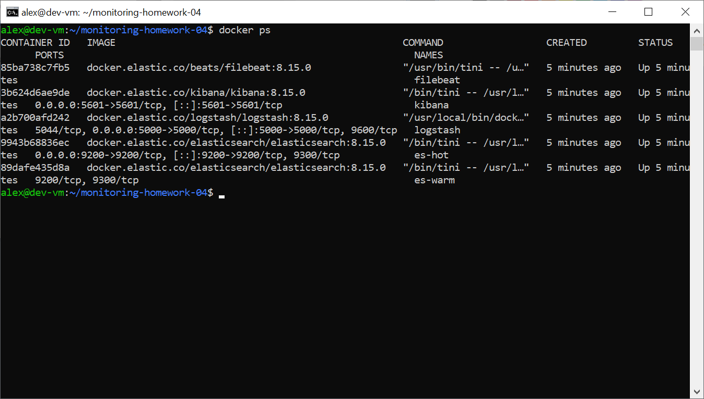
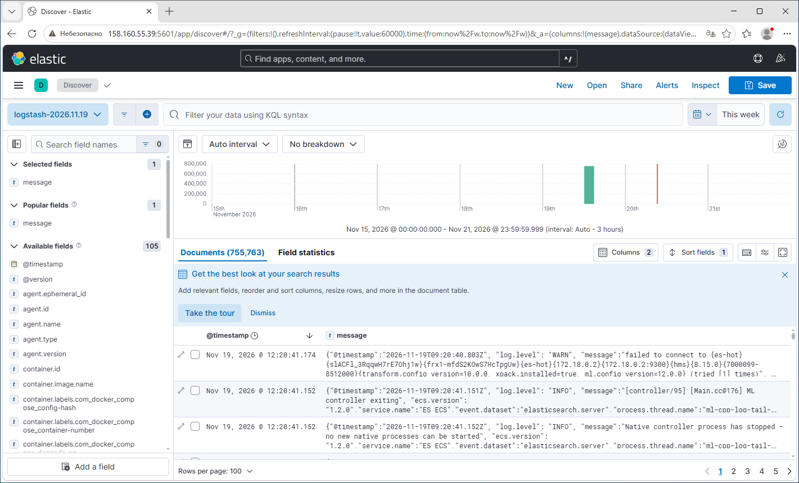

# Домашнее задание к занятию 15 «Система сбора логов Elastic Stack»

## Задание 1. Поднятие стека в Docker

Стек развёрнут через `docker-compose.yml`, 5 сервисов:
`es-hot`, `es-warm`, `logstash`, `kibana`, `filebeat`.

- **Elasticsearch**: два узла, `es-hot` (роли `master,data_hot,data_content`)
  и `es-warm` (роли `master,data_warm,data_content`). Кластер `elk-cluster`,
  статус `green`, 2 узла, 31 primary-шард, 60 активных, 0 неназначенных.
- **Logstash**: принимает TCP JSON на порту `5000` (codec `json_lines`)
  и Beats на порту `5044`. Отправляет документы в Elasticsearch в индекс
  `logstash-%{+YYYY.MM.dd}`.
- **Filebeat**: собирает логи Docker-контейнеров через `autodiscover`
  (провайдер `docker`, `hints.default_config` с `filestream` и `container`
  парсером) и отправляет их в Logstash.
- **Kibana**: доступна на `http://localhost:5601`, подключена к `es-hot`.

> Роли `data_content` добавлены обоим узлам, так как в Elasticsearch 8
> индексы по умолчанию требуют тир `data_content`; без этого шарды
> остаются в состоянии `UNASSIGNED`, и кластер имеет статус `red`.

### Скриншот `docker ps` через 5 минут после старта



### Скриншот Kibana (Discover)



### Конфигурация

- [`docker-compose.yml`](docker-compose.yml)
- [`logstash/pipeline/logstash.conf`](logstash/pipeline/logstash.conf)
- [`filebeat/filebeat.yml`](filebeat/filebeat.yml)

## Задание 2. Index Patterns и Discover

В Kibana создан Data View (index pattern) `logstash-*` с полем времени
`@timestamp` (маппинг в Elasticsearch — `date`, подтверждено запросом
`_mapping`). Логи из Docker-контейнеров поступают в Elasticsearch:
индексы `logstash-2026.11.19` и `logstash-2026.11.20` суммарно содержат
более 700 000 документов. В Discover проверены отображение событий и
поиск по полям, включая поиск по тексту `message`.

## Запуск

```bash
sudo sysctl -w vm.max_map_count=262144
docker compose up -d
curl -s http://localhost:9200/_cluster/health?pretty
curl -s "http://localhost:9200/_cat/indices?v"
